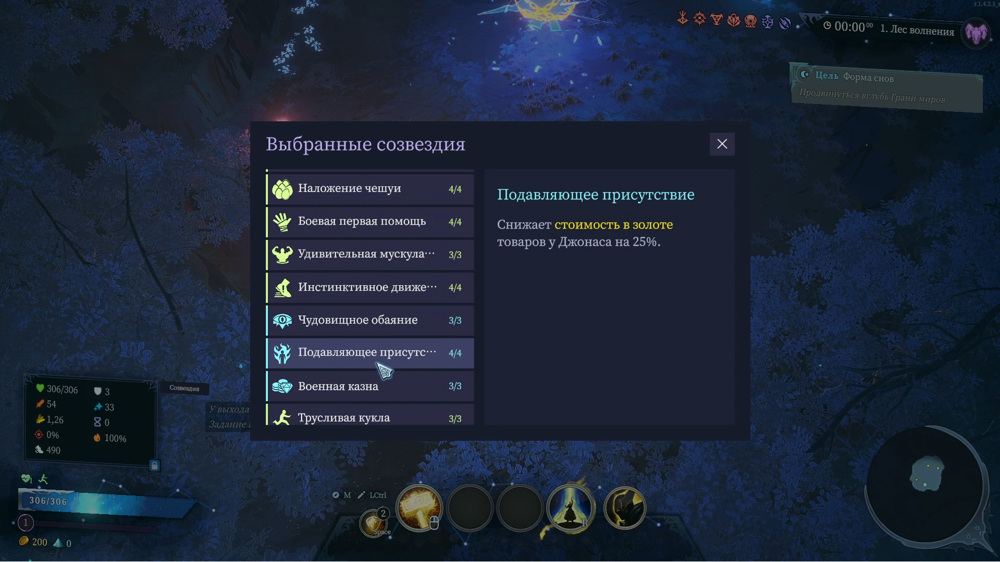
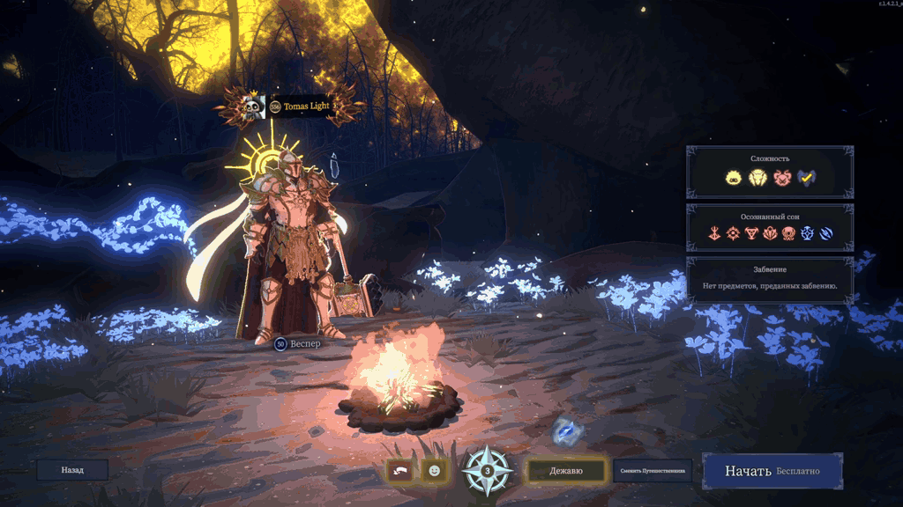

# Constellation Viewer

## Русский

Во время забега откройте панель характеристик персонажа и нажмите **Созвездия** рядом с ней. Если вы открыли панель удержанием клавиши, после нажатия её можно отпустить. Наведите курсор на звезду, чтобы увидеть описание её эффекта на текущем уровне. Окно доступно только для просмотра.

## English

During a run, open the character stats panel and click **Constellations** beside it. If you held a key to show the panel, you can release it once the window opens. Hover over an equipped star to see its effect at the equipped level. The window is read-only.

## Демонстрация / Gameplay

