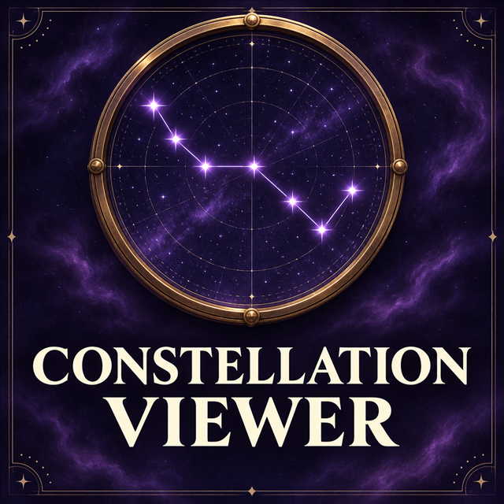
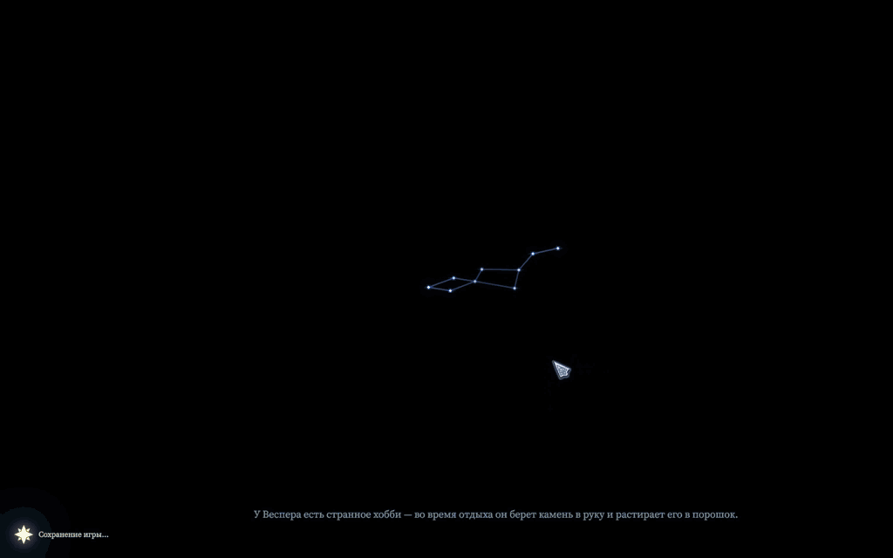

# Constellation Viewer

https://steamcommunity.com/sharedfiles/filedetails/?id=3846266686

## Русский

Во время забега откройте панель характеристик персонажа и нажмите **Созвездия** рядом с ней. Если вы открыли панель удержанием клавиши, после нажатия её можно отпустить. Наведите курсор на звезду, чтобы увидеть описание её эффекта на текущем уровне. Окно доступно только для просмотра.

Окно созвездий автоматически использует язык игры. Поддерживаются все 13 языков.

## English

During a run, open the character stats panel and click **Constellations** beside it. If you held a key to show the panel, you can release it once the window opens. Hover over an equipped star to see its effect at the equipped level. The window is read-only.

The constellation window automatically uses the game’s language. All 13 languages are supported.

## Deutsch

Klicke während eines Laufs neben den Charakterwerten auf „Konstellationen“. Zeige mit der Maus auf einen Stern, um seinen Effekt auf der aktuellen Stufe zu sehen. Das Fenster zeigt auch den Malus für einen unpassenden Platz. Du kannst die Auswahl hier ansehen. Alle 13 Spielsprachen werden unterstützt.

Wenn du die Werte mit einer Taste geöffnet hast, kannst du sie loslassen, sobald das Fenster offen ist.

## Español (Latinoamérica)

Durante una partida, haz clic en «Constelaciones» junto a las estadísticas. Pasa el cursor sobre una estrella para ver su efecto en el nivel actual y la penalización si está en una ranura de otro tipo. La ventana sirve para consultar tus estrellas. Se admiten los 13 idiomas del juego.

Si mantuviste una tecla para abrir las estadísticas, puedes soltarla cuando se abra la ventana.

## Français

En cours de partie, cliquez sur « Constellations » à côté des statistiques. Survolez une étoile pour voir son effet au niveau actuel et le malus si l’emplacement est d’un autre type. Cette fenêtre sert à consulter vos étoiles. Les 13 langues du jeu sont prises en charge.

Si vous avez maintenu une touche pour afficher les statistiques, vous pouvez la relâcher à l’ouverture de la fenêtre.

## Italiano

Durante la partita, fai clic su «Costellazioni» accanto alle statistiche. Passa il puntatore su una stella per vedere l’effetto al livello attuale e la penalità se lo slot è di un altro tipo. La finestra serve a consultare le stelle equipaggiate. Sono supportate tutte e 13 le lingue del gioco.

Se hai tenuto premuto un tasto per mostrare le statistiche, puoi rilasciarlo dopo l’apertura della finestra.

## 日本語

プレイ中にステータス欄の横にある「星座」を押します。星にカーソルを合わせると、現在のレベルでの効果と、異なる種類のスロットに装備したときのペナルティが表示されます。このウィンドウで装備中の星を確認できます。ゲームの全13言語に対応しています。

キーを押し続けてステータス欄を出した場合は、ウィンドウが開いたらキーを離せます。

## 한국어

플레이 중 능력치 창 옆의 ‘별자리’를 클릭하세요. 별 위에 커서를 올리면 현재 레벨의 효과와 다른 유형의 슬롯에 장착했을 때의 불이익을 볼 수 있습니다. 이 창에서 장착한 별을 확인할 수 있습니다. 게임의 13개 언어를 모두 지원합니다.

키를 누른 채로 능력치 창을 열었다면 별자리 창이 열린 뒤 키를 놓아도 됩니다.

## Polski

Podczas rozgrywki kliknij „Konstelacje” obok statystyk postaci. Najedź kursorem na gwiazdę, aby zobaczyć efekt na obecnym poziomie i karę za gniazdo innego typu. W tym oknie możesz przejrzeć wyposażone gwiazdy. Mod obsługuje wszystkie 13 języków gry.

Jeśli statystyki są otwarte przez przytrzymanie klawisza, możesz go puścić po otwarciu okna.

## Português (Brasil)

Durante uma partida, clique em “Constelações” ao lado dos atributos do personagem. Passe o cursor sobre uma estrela para ver o efeito no nível atual e a penalidade por usar um espaço de outro tipo. A janela serve para consultar suas estrelas. Os 13 idiomas do jogo são compatíveis.

Se você segurou uma tecla para abrir os atributos, pode soltá-la quando a janela abrir.

## Türkçe

Oyun sırasında karakter istatistiklerinin yanındaki “Takımyıldızlar” düğmesine tıkla. Güncel seviyedeki etkiyi ve farklı türde bir yuvanın cezasını görmek için imleci bir yıldızın üzerine getir. Bu pencerede kuşanılan yıldızları görebilirsin. Oyunun 13 dilinin tümü desteklenir.

İstatistikleri görmek için bir tuşu basılı tuttuysan pencere açılınca tuşu bırakabilirsin.

## 简体中文

在一局游戏中，点击角色属性旁的“星座”。将鼠标指向星星，即可看到当前等级的效果，以及放入不同类型插槽时的惩罚。这个窗口可查看已装备的星星。支持游戏的全部 13 种语言。

如果是按住按键展开角色属性，窗口打开后就可以松开按键。

## 繁體中文

在一局遊戲中，點選角色屬性旁的「星座」。將游標指向星星，即可看到目前等級的效果，以及放入不同類型欄位時的懲罰。這個視窗可查看已裝備的星星。支援遊戲的全部 13 種語言。

如果是按住按鍵展開角色屬性，視窗開啟後就可以放開按鍵。

## Демонстрация / Gameplay

