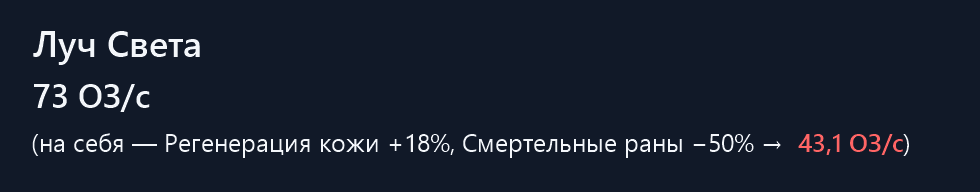

# Effect Breakdown

## Русский

Effect Breakdown добавляет расчёт исцеления, барьеров, урона и перезарядки в подсказки воспоминаний и эссенций. В забеге мод читает активные эффекты героя. В «Дежавю» он использует выбранные звёзды, сложность и усложнения. Если навык может выбрать союзника, итог зависит от эффектов на выбранном союзнике.

Мод ищет числовые выражения в коде установленной игры. Он добавляет поправку, когда может связать число с эффектом и рассчитать применимый модификатор. Для урона итог приводится до защиты цели. При активной «Осторожной медузе» мод показывает уменьшенный итог для сокращений в секундах и поясняет, почему процентные сокращения вроде эффекта «Эссенции потока» сохраняют свой размер. Поддержка условных взаимодействий частичная.

## English

Effect Breakdown adds healing, barrier, damage, and cooldown estimates to Memory and Essence tooltips. During a run, it reads the hero's active effects. In Déjà Vu, it uses the selected stars, difficulty, and Lucid Dreams. When a skill can pick an ally, the result depends on that ally's effects.

The mod discovers numeric expressions from the installed game's code. It shows a breakdown when it can trace the number to an effect and calculate an applicable modifier. Damage estimates are shown before target defenses. With Prudent Jellyfish active, flat cooldown reductions show their reduced value and percentage-based effects such as Essence of Flow explain why their value stays the same. Coverage of conditional interactions is partial.

## Демонстрация / Gameplay

Пример оформления подсказки для «Луча Света». / Example of a Beam of Light tooltip.

[Сборка и установка / Build and install](../build.md#effect-breakdown)
