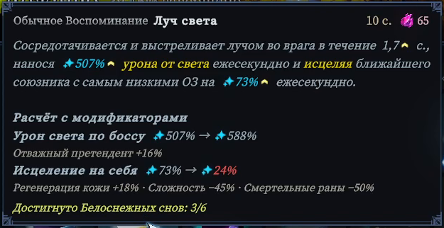

# Effect Breakdown

## Русский

Effect Breakdown добавляет расчёт исцеления, барьеров, урона и перезарядки в подсказки воспоминаний и эссенций. В забеге мод читает активные эффекты героя. В «Дежавю» и при выборе воспоминаний путешественника в лобби он использует выбранные звёзды, сложность и усложнения. Если навык может выбрать союзника, итог зависит от эффектов на выбранном союзнике.

Мод ищет числовые выражения в коде установленной игры. Он добавляет поправку, когда может связать число с эффектом и рассчитать применимый модификатор. Для урона итог приводится до защиты цели. При активной «Осторожной медузе» мод показывает уменьшенный итог для сокращений в секундах и поясняет, почему процентные сокращения вроде эффекта «Эссенции потока» сохраняют свой размер. Поддержка условных взаимодействий частичная.

Расчёт автоматически отображается на языке игры. Поддерживаются все 13 языков.

## English

Effect Breakdown adds healing, barrier, damage, and cooldown estimates to Memory and Essence tooltips. During a run, it reads the hero's active effects. In Déjà Vu and when choosing Traveler Memories in the lobby, it uses the selected stars, difficulty, and Lucid Dreams. When a skill can pick an ally, the result depends on that ally's effects.

The mod discovers numeric expressions from the installed game's code. It shows a breakdown when it can trace the number to an effect and calculate an applicable modifier. Damage estimates are shown before target defenses. With Prudent Jellyfish active, flat cooldown reductions show their reduced value and percentage-based effects such as Essence of Flow explain why their value stays the same. Coverage of conditional interactions is partial.

The breakdown automatically uses the game’s language. All 13 languages are supported.

## Демонстрация / Gameplay

Подсказки в лобби и «Дежавю». / Tooltips in the lobby and Déjà Vu.

**«Рассечение» / Laceration.** В лобби видны перезарядка 7,5 → 5,25 с и отдельные строки для обеих форм. / The lobby tooltip shows a cooldown of 7.5 → 5.25 s and separate rows for both forms.

**«Луч света» / Beam of Light.** Исцеление на себя снижается с 73% до 24% силы умений с учётом «Регенерации кожи», сложности «Кошмар» и «Смертельных ран». / Self-healing falls from 73% to 24% of Ability Power with Skin Regeneration, Nightmare difficulty, and Grievous Wounds.

**«Эссенция потока» / Essence of Flow.** «Осторожная медуза» оставляет процентное сокращение перезарядки без изменений. / Prudent Jellyfish leaves percentage-based cooldown reduction unchanged.

