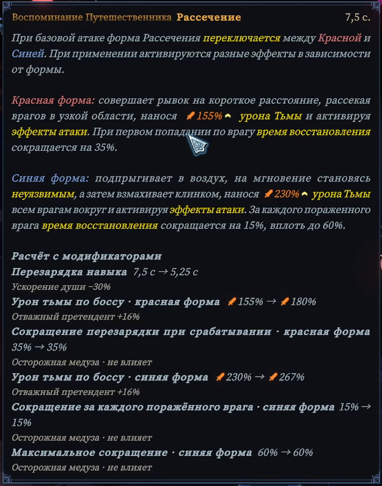
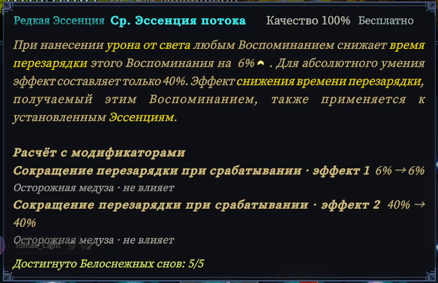

# Effect Breakdown

## Русский

Effect Breakdown добавляет расчёт исцеления, барьеров, урона и перезарядки в подсказки воспоминаний и эссенций. В забеге мод читает активные эффекты героя. В «Дежавю» и при выборе воспоминаний путешественника в лобби он использует выбранные звёзды, сложность и усложнения. Если навык может выбрать союзника, итог зависит от эффектов на выбранном союзнике.

Мод ищет числовые выражения в коде установленной игры. Он добавляет поправку, когда может связать число с эффектом и рассчитать применимый модификатор. Для урона итог приводится до защиты цели. При активной «Осторожной медузе» мод показывает уменьшенный итог для сокращений в секундах и поясняет, почему процентные сокращения вроде эффекта «Эссенции потока» сохраняют свой размер. Поддержка условных взаимодействий частичная.

Расчёт автоматически отображается на языке игры. Поддерживаются все 13 языков.

## English

Effect Breakdown adds healing, barrier, damage, and cooldown estimates to Memory and Essence tooltips. During a run, it reads the hero's active effects. In Déjà Vu and when choosing Traveler Memories in the lobby, it uses the selected stars, difficulty, and Lucid Dreams. When a skill can pick an ally, the result depends on that ally's effects.

The mod discovers numeric expressions from the installed game's code. It shows a breakdown when it can trace the number to an effect and calculate an applicable modifier. Damage estimates are shown before target defenses. With Prudent Jellyfish active, flat cooldown reductions show their reduced value and percentage-based effects such as Essence of Flow explain why their value stays the same. Coverage of conditional interactions is partial.

The breakdown automatically uses the game’s language. All 13 languages are supported.

## Deutsch

Die Tooltips für Erinnerungen und Essenzen zeigen Heilung, Barrieren, Schaden und Abklingzeit mit den aktuellen Modifikatoren. Das gilt im Lauf, in Déjà-vu und bei der Auswahl von Reisenden-Erinnerungen in der Lobby. Die Quellen stehen dabei, schlechtere Werte sind rot. Heilung und Barrieren gelten für den Besitzer. Bedingter Schaden nennt den Zieltyp. Alle 13 Spielsprachen werden unterstützt.

Im Lauf nutzt der Mod aktive Effekte der Figur. In der Lobby zählen die gewählten Sterne, die Schwierigkeit und die Klarträume. Bei einem Verbündeten hängt die Heilung von dessen Effekten ab. Der Schaden gilt vor der Zielverteidigung. Der Quallen-Modifikator schwächt Abklingzeitverkürzungen in Sekunden ab. Prozentuale Verkürzungen wie bei der Essenz des Flusses bleiben gleich. Manche Bedingungen lassen sich nur teilweise auswerten.

## Español (Latinoamérica)

Las descripciones de recuerdos y esencias muestran la curación, las barreras, el daño y el tiempo de reutilización con los modificadores activos. Puedes ver el cálculo en la partida, en Déjà Vu y al elegir recuerdos del viajero en el lobby. Se muestran las fuentes y los empeoramientos salen en rojo. La curación y las barreras se calculan para el portador. El daño condicional indica el tipo de objetivo. Se admiten los 13 idiomas.

Durante la partida se usan los efectos activos del personaje. En el lobby se usan las estrellas elegidas, la dificultad y los sueños lúcidos. Si el objetivo es un aliado, la curación depende de sus efectos. El daño se calcula antes de aplicar la defensa del objetivo. El sueño de la medusa reduce los recortes en segundos. Los recortes porcentuales, como el de la Esencia de flujo, conservan su valor. Algunas interacciones solo se pueden mostrar en parte.

## Français

Les infobulles des souvenirs et des essences affichent le calcul des soins, des boucliers, des dégâts et du temps de recharge. Le calcul apparaît en partie, dans Déjà-vu et lors du choix des souvenirs du voyageur dans le salon. Les sources sont indiquées et les valeurs moins favorables sont en rouge. Les soins et les boucliers sont calculés pour le porteur. Les dégâts conditionnels indiquent le type de cible. Les 13 langues sont prises en charge.

En partie, le mod utilise les effets actifs du personnage. Dans le salon, il utilise les étoiles choisies, la difficulté et les rêves lucides. Pour un allié, les soins dépendent des effets qui l’affectent. Les dégâts sont calculés avant la défense de la cible. Le rêve de la méduse diminue les réductions exprimées en secondes. Les réductions en pourcentage, comme celle de l’essence de flux, gardent leur valeur. Certaines interactions sont couvertes en partie.

## Italiano

Le descrizioni di ricordi ed essenze mostrano il calcolo di cure, barriere, danni e tempi di recupero. Lo vedi in partita, in Déjà Vu e quando scegli i ricordi del viaggiatore nella lobby. Il mod indica da dove vengono le modifiche e mostra in rosso i valori peggiorati. Cure e barriere sono calcolate per il portatore. Per i danni condizionali è indicato il tipo di bersaglio. Sono supportate tutte e 13 le lingue.

In partita il mod usa gli effetti attivi del personaggio. Nella lobby usa le stelle scelte, la difficoltà e i sogni lucidi. La cura di un alleato dipende dagli effetti su di lui. I danni sono calcolati prima della difesa del bersaglio. Il sogno della medusa attenua le riduzioni in secondi. Le riduzioni percentuali, come quella dell’essenza del flusso, restano uguali. Alcune interazioni sono coperte solo in parte.

## 日本語

記憶とエッセンスの説明に、回復、バリア、ダメージ、クールダウンの計算を表示します。プレイ中、デジャヴ、ロビーで旅人の記憶を選ぶときに確認できます。補正の出どころを表示し、不利な結果は赤で示します。回復とバリアは装備者に対する値です。条件付きのダメージには対象の種類を表示します。全13言語に対応しています。

プレイ中はキャラクターにかかっている効果、ロビーでは選んだ星、難易度、明晰夢を使います。味方を回復する量は、その味方の効果で変わります。ダメージは対象の防御を適用する前の値です。クラゲの明晰夢は秒数で表す短縮量を減らします。流れのエッセンスなど、割合で表す短縮量は変わりません。一部の条件付き効果には対応していません。

## 한국어

기억과 정수의 툴팁에 치유, 보호막, 피해, 재사용 대기시간 계산이 표시됩니다. 플레이 중, 데자뷔, 로비에서 여행자의 기억을 고를 때 확인할 수 있습니다. 변경 요인이 표시되며 불리한 결과는 빨간색으로 보입니다. 치유와 보호막은 소유자 기준으로 계산합니다. 조건부 피해에는 대상 유형이 표시됩니다. 13개 언어를 모두 지원합니다.

플레이 중에는 캐릭터에게 적용된 효과를 사용합니다. 로비에서는 선택한 별, 난이도, 자각몽을 사용합니다. 아군의 치유량은 그 아군에게 적용된 효과에 따라 달라집니다. 피해는 대상의 방어를 적용하기 전 수치입니다. 해파리 자각몽은 초 단위 감소량을 줄입니다. 흐름의 정수처럼 비율로 표시되는 감소량은 그대로입니다. 일부 조건부 효과는 부분적으로 지원합니다.

## Polski

Podpowiedzi wspomnień i esencji pokazują obliczenia leczenia, tarcz, obrażeń i czasu odnowienia. Są dostępne w trakcie gry, w Déjà Vu i przy wyborze wspomnień podróżnika w poczekalni. Widać źródła zmian, a gorsze wyniki są czerwone. Leczenie i tarcze są liczone dla właściciela. Obrażenia warunkowe mają oznaczony typ celu. Mod obsługuje wszystkie 13 języków.

W trakcie gry mod korzysta z aktywnych efektów postaci. W poczekalni bierze pod uwagę wybrane gwiazdy, poziom trudności i świadome sny. Leczenie sojusznika zależy od efektów, które na niego działają. Obrażenia są liczone przed obroną celu. Sen z meduzą osłabia skrócenia wyrażone w sekundach. Skrócenia procentowe, na przykład z esencji przepływu, zachowują swój procent. Niektóre interakcje są obsługiwane częściowo.

## Português (Brasil)

As dicas de memórias e essências mostram o cálculo de cura, barreiras, dano e tempo de recarga. Dá para ver o cálculo durante a partida, no Déjà Vu e ao escolher memórias do viajante no lobby. As fontes aparecem e os resultados piores ficam em vermelho. A cura e as barreiras são calculadas para o dono. O dano condicional mostra o tipo de alvo. Os 13 idiomas são compatíveis.

Na partida, o mod usa os efeitos ativos do personagem. No lobby, usa as estrelas escolhidas, a dificuldade e os sonhos lúcidos. A cura de um aliado depende dos efeitos sobre ele. O dano é calculado antes da defesa do alvo. O sonho da água-viva diminui a redução em segundos. Reduções percentuais, como a da essência do fluxo, mantêm o mesmo valor. Algumas interações têm suporte parcial.

## Türkçe

Hafıza ve öz açıklamalarında iyileştirme, bariyer, hasar ve bekleme süresi hesabı gösterilir. Hesabı oyun sırasında, Déjà Vu’da ve lobide gezgin hafızalarını seçerken görebilirsin. Değişikliğin kaynakları gösterilir ve daha kötü sonuçlar kırmızı renktedir. İyileştirme ve bariyer sahibine göre hesaplanır. Koşullu hasarda hedef türü belirtilir. 13 dilin tümü desteklenir.

Oyun sırasında karakterin etkin etkileri kullanılır. Lobide seçilen yıldızlar, zorluk ve berrak rüyalar hesaba katılır. Bir müttefikin iyileştirilmesi, üzerindeki etkilere bağlıdır. Hasar hedefin savunmasından önce hesaplanır. Denizanası rüyası saniye cinsinden azaltmaları zayıflatır. Akış Özü gibi yüzdeyle verilen azaltmalar aynı kalır. Bazı etkileşimler kısmen desteklenir.

## 简体中文

记忆和精华的提示会显示治疗、护盾、伤害和冷却时间的计算结果。你可以在对局中、Déjà Vu 和大厅选择旅人记忆时查看。提示会列出修正来源，变差的结果用红色标出。治疗和护盾按拥有者计算，条件伤害会标明目标类型。支持全部 13 种语言。

对局中按角色的当前效果计算。大厅里按所选星星、难度和清醒梦计算。治疗队友时，结果取决于队友身上的效果。伤害是应用目标防御前的数值。水母清醒梦会减弱按秒计算的冷却缩减。流动精华等按百分比计算的缩减保持原值。部分条件效果只有部分支持。

## 繁體中文

記憶和精華的提示會顯示治療、護盾、傷害和冷卻時間的計算結果。你可以在對局中、Déjà Vu 和大廳選擇旅人記憶時查看。提示會列出修正來源，變差的結果以紅色標示。治療和護盾以擁有者為準，條件傷害會標明目標類型。支援全部 13 種語言。

對局中按角色的目前效果計算。大廳裡按所選星星、難度和清醒夢計算。治療隊友時，結果取決於隊友身上的效果。傷害是套用目標防禦前的數值。水母清醒夢會減弱按秒計算的冷卻縮減。流動精華等按百分比計算的縮減維持原值。部分條件效果只有部分支援。

## Демонстрация / Gameplay

Подсказки в лобби и «Дежавю». / Tooltips in the lobby and Déjà Vu.

**«Рассечение» / Laceration.** В лобби видны перезарядка 7,5 → 5,25 с и отдельные строки для обеих форм. / The lobby tooltip shows a cooldown of 7.5 → 5.25 s and separate rows for both forms.

**«Луч света» / Beam of Light.** Исцеление на себя снижается с 73% до 24% силы умений с учётом «Регенерации кожи», сложности «Кошмар» и «Смертельных ран». / Self-healing falls from 73% to 24% of Ability Power with Skin Regeneration, Nightmare difficulty, and Grievous Wounds.

**«Эссенция потока» / Essence of Flow.** «Осторожная медуза» оставляет процентное сокращение перезарядки без изменений. / Prudent Jellyfish leaves percentage-based cooldown reduction unchanged.

